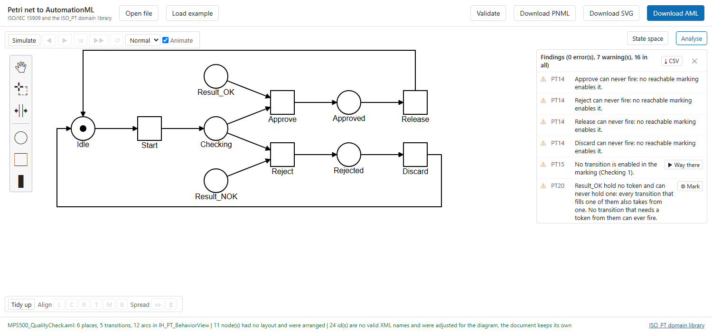

# AMLPetriNet

Place/transition Petri nets (ISO/IEC 15909) in AutomationML.

- Plugin for the AutomationML Editor to view and edit nets inside AML documents
- Mapper between PNML and CAEX 3.0, based on the `ISO_PT` domain library
- Command line tool and web application

Online: https://aml.fpbjs.net/pt/



The counterpart for the Formalised Process Description (VDI/VDE 3682) is
[AMLFPB.js](https://github.com/hsu-aut/AMLFPB.js).

## Repository

| Path | Content |
|---|---|
| `Aml.Editor.Plugin.PetriNet/` | AutomationML Editor plugin |
| `dotnet/PtMapper.Conversion/` | Mapper library |
| `dotnet/PtMapper.Tool/` | Command line tool `ptmap` |
| `dotnet/PtMapper.Web/` | Web application |
| `dotnet/PtMapper.Tests/` | Mapper tests |
| `web/` | The bundle for plugin and web application, host bridge, browser tests |
| `libraries/` | `ISO_PT` domain library and the libraries it references |
| `examples/` | Example documents, including the MPS500 quality check in `examples/paper/` |
| `docs/` | Round-trip validation, PNML conformance, plans and the backlog |

The Petri net modeler itself is [PetriNet.js](https://github.com/hsu-aut/PetriNet.js),
a repository of its own: canvas, PNML reader and writer, simulation, analysis
core, state space view. `web/` installs it from a tag.

## Install the plugin

To use the plugin without building it:

1. Close every running AutomationML Editor. An update made while a second
   instance is open can leave the plugin folder half written.
2. Download `Aml.Editor.Plugin.PetriNet.<version>.nupkg` from the
   [latest release](https://github.com/hsu-aut/AMLPetriNet/releases/latest) and
   put it in a folder of its own.
3. Start the editor, open the PlugIn Manager and add that folder as a package
   source.
4. Select the source, find AMLPetriNet (package `Aml.Editor.Plugin.PetriNet`)
   under Available and install it. An update comes through the Updates tab.
5. The PlugIn Manager keeps showing "Loading an AutomationML Editor PlugIn"
   until you confirm the message "Restart required". That message is a separate
   window and may sit behind the editor; look for it in the taskbar.
6. Restart the editor. The plugin appears as the tab "AMLPetriNet". It needs
   the AutomationML Editor 6.4 or later and the WebView2 runtime, which comes
   with current Windows and Edge.

What the plugin does is described under [Plugin](#plugin) below.

## Build

Requires the .NET 8 SDK and Node.js 20. The plugin needs Windows, the
AutomationML Editor 6.4 or later and the WebView2 runtime.

```bash
cd web
npm ci
npm run build
cd ..
dotnet build Aml.Editor.Plugin.PetriNet.sln
```

The modeler bundle is built first because the plugin and the web application
include it. `npm ci` in `web` installs PetriNet.js from its tag on GitHub. The plugin package ends up in
`build/Plugins/Aml.Editor.Plugin.PetriNet/<configuration>/`.

## Plugin

- The canvas shows a net of the open document; a list switches between nets.
- **Simulate** fires the net on the canvas: enabled transitions are marked, a
  click fires one, and the run can be stepped back or played. The document is
  not touched by a run; the marking it holds is the one the user typed.
- **Analyse** lists what the net does: how many tokens a place can hold,
  transitions that can never fire, deadlocks, liveness, invariants, siphons and
  traps. A finding leads to the element it is about, rings the set of elements
  it covers, or hands over the firings that lead into the marking it names.
- **State space** draws every marking the net can reach and the firings between
  them; a click walks the net into that marking, and the query line answers
  whether a marking you have in mind is reachable, with the way there.
- **Marking and search.** A run's marking can become the initial marking of the net
  (one undo). A search that hit its limit can be repeated once with ten times the
  limits, and "Why" shows the firings into the marking where a transition is lost.
- **Tidy up** lays the net out by its flow in one undoable step; a selection can
  be lined up and spread evenly.
- Both panels save what they show: the state space as DOT for a graph tool, the
  markings and the findings as tables.
- A click on the canvas selects the same element in the editor's tree, which the
  settings can turn off.
- **Update** writes the net into the document. Elements are updated in place,
  so attributes and links added by others are kept.
- **Refresh** reloads the net from the document.
- The **Net** menu creates a new net, starts and stops a simulation, analyses the
  net, imports and exports PNML and SVG, and saves a conformance report.

Do not copy `Aml.Editor.Plugin.Contract.dll` into an installed plugin folder.
The editor ignores the plugin without an error message if it finds a second
copy.

## Web application

```bash
dotnet run --project dotnet/PtMapper.Web
```

| Endpoint | Function |
|---|---|
| `POST /api/to-pnml` | AML in, PNML out (`?hierarchy=` selects the hierarchy) |
| `POST /api/update` | `{aml, pnml, hierarchy}` in, the same AML document with the updated net out |
| `POST /api/to-aml` | PNML in, new AML document out |
| `POST /api/validate` | AML or PNML in, findings as JSON out |
| `GET /api/library` | `ISO_PT` domain library |
| `GET /api/health` | Status and library version |

Requests are limited to 8 MB and 60 per minute per client. The page uses
relative paths, so the app can run under a path behind a reverse proxy. In that
case set `PT_PROXY_KEY` on both sides; the proxy sends it in `X-Proxy-Key`
together with the client address in `X-Client-Address`.

## Command line

```bash
dotnet run --project dotnet/PtMapper.Tool -- <command>
```

| Command | Function |
|---|---|
| `to-aml <in.pnml> <out.aml> [hierarchy]` | PNML to a new AML document |
| `to-pnml <in.aml> <out.pnml> [hierarchy]` | Net of an AML document to PNML |
| `roundtrip <in.aml> [hierarchy]` | Round trip in both directions with a report of the differences |
| `compare <before.aml> <after.aml> [hierarchy]` | Differences between two versions of a document |
| `validate <in.pnml or in.aml>` | Structural checks, non-zero exit code on errors |
| `analyze <in.pnml or in.aml> [hierarchy] [options]` | The structural rules and the behaviour of the net (deadlocks, bounds, liveness, invariants) in one report, as text or JSON, with an exit code for CI. Needs Node.js 20 or later at run time |
| `explore <in.pnml or in.aml> [hierarchy] [options]` | The state space of one net as DOT (Graphviz) or CSV, the text the state space view saves. `--net id`, `--format dot|csv`, `--output file`, `--markings N`, `--time-limit ms`, `--timeout s`, `--partial` (write a search that stopped at its limit; otherwise exit 5 and nothing is written). Exit codes as for `analyze`, except 5 means the search stopped and 4 that the net breaks ISO/IEC 15909-1. ptmap has no time limit by default, so it can write more than the view does. Needs Node.js 20 or later |
| `report <in> <out.md>` | Checks as a Markdown report |
| `library <out.aml>` | Writes the `ISO_PT` domain library |
| `selfcontained <in.aml> <out.aml>` | Embeds the referenced libraries into a document |

### `ptmap analyze`

```bash
dotnet run --project dotnet/PtMapper.Tool -- analyze examples/quality-gate.pnml
dotnet run --project dotnet/PtMapper.Tool -- analyze doc.aml IH_PT_View --format json --fail-on error
```

Options: `--format text|json|sarif|junit`, `--output file`, `--fail-on error|warning|never` (default `warning`),
`--markings N` (default 20000), `--time-limit ms` (default none, so the answer is
the same on every machine), `--timeout s` (default 120, kills the analysis),
`--all` (lists the information findings, the text only counts them otherwise) and
`--require-complete` (a partial result fails the run: a search that stopped at its
limit, or a net with an unbounded place; it holds whatever `--fail-on` says about
warnings). `--fail-on never` leaves only the codes 1 to 3.

`--format sarif` writes SARIF 2.1.0 for GitHub code scanning: one result per finding, at
line 1 of the file (GitHub shows no other place), with the element in the message and as
a logical location. Information findings come in only with `--all`, as notes. The
fingerprint leaves out wording and path, so rewording a message keeps the alert.
`--format junit` writes one test suite per net and one test case per rule; a rule fails
its test case on an error or a warning. The format never changes the exit code.
`--output file` writes the report as UTF-8 without a byte order mark (a `>` in Windows
PowerShell 5.1 writes UTF-16, which SARIF uploads refuse), only when the run succeeds,
and prints one summary line.

| Exit code | Meaning |
|---|---|
| 0 | nothing at or above `--fail-on` |
| 1 | wrong use |
| 2 | no file, no net, no such hierarchy, Node.js 20 or the analysis bundle missing |
| 3 | the analysis failed, ran into `--timeout`, or gave no result for a net |
| 4 | at least one error |
| 5 | at least one warning, no error (`validate` exits 0 on warnings) |

Code scanning on GitHub, with the findings of a net in the repository:

```yaml
permissions:
  contents: read
  security-events: write
steps:
  - uses: actions/checkout@v4
  - run: dotnet ptmap.dll analyze nets/line.pnml --format sarif --output ptmap.sarif --fail-on never
  - uses: github/codeql-action/upload-sarif@v3
    with: { sarif_file: ptmap.sarif }
```

GitHub shows a result at a line of a file. A net has no lines, so every result points at
line 1 and names the element in its text. The same file uploaded from two paths is two
analyses. Uploading the quality gate of this repository would keep a deadlock open for
ever, so the repository's own CI does not upload.

The report also names the class of the net (state machine, marked graph,
free-choice and so on) and, for a workflow net, whether it is sound. A statement
proven from the structure starts with "Proven from the structure" and carries
`proof` in the JSON. A workflow net that is not sound is a warning, so it exits 5.

The behaviour is computed by the analysis core of PetriNet.js, in a Node process,
so a file gives the same findings here as on the canvas. The bundle is built by
`npm run build` in `web/` and copied next to `ptmap.dll`.

## Representation in AML

```
InstanceHierarchy
  PT_Net
    PT_Place, PT_Transition   one PT_NodeArcEnd interface per connected arc
    PT_Arc                   PT_ArcSource and PT_ArcTarget interfaces
    InternalLink             two per arc, from arc interface to node interface
```

Layout uses the `OMG_DD_AttributeTypeLib`: `ViewInformation` on nodes,
`Waypoint_1..n` on arcs, `PortCoordinate` on arc interfaces and `LabelOffset`
for moved labels. Nodes without a position are arranged when a net is loaded.

## Checks

| Rule | Check |
|---|---|
| PT01 | Identifiers are unique |
| PT02 | Every element has an identifier |
| PT03 | Arcs connect a place and a transition |
| PT04 | Both ends of an arc are nodes of the net |
| PT05 | No parallel arcs between the same nodes (warning) |
| PT06 | Initial markings are not negative |
| PT07 | Arc weights are positive |
| PT08 | No unconnected nodes (warning) |
| PT09 | No transition without an input place (warning) |
| PT10 | No transition without an output place (warning) |
| PT11 | Identifiers are valid XML names |
| PT12 | Unbounded place (shown as omega) |
| PT13 | The bound of a place |
| PT14 | Dead transition: it can never fire, with the place that never holds enough |
| PT15 | Deadlock: a marking in which nothing is enabled |
| PT16 | Not live: a transition that can never fire again, with the marking where it is lost |
| PT17 | Partial result: the search stopped at its limit |
| PT18 | Place invariant |
| PT19 | Transition invariant |
| PT20 | Siphon without a token |
| PT21 | Trap |
| PT22 | Net class (state machine, marked graph, free-choice and so on) |
| PT23 | Liveness proven from the structure |
| PT24 | Boundedness proven from the structure |
| PT25 | Workflow net soundness |

## Tests

```bash
dotnet test dotnet/PtMapper.Tests
dotnet test Aml.Editor.Plugin.PetriNet.Tests
cd web && npm test
```

The plugin's own tests cover the parts of it that are plain data: the messages
the modeler sends and the settings that are stored between sessions. Everything
else in the plugin needs a running AutomationML Editor.

`npm test` drives the bundled modeler in Chromium, as the plugin and the web
application use it: the host bridge, the interop fixtures and the picture. What
the modeler does on its own (the PNML round trip, simulation, analysis, exports,
layout) is tested in PetriNet.js, in Node and in Chromium.

`web/tools/validate-pnml.mjs` checks PNML files against the ISO/IEC 15909-2
grammar and needs Java. Results are described in
[docs/roundtrip-validation.md](docs/roundtrip-validation.md) and
[docs/pnml-conformance.md](docs/pnml-conformance.md).

## License

MIT, see [LICENSE](LICENSE).

[PetriNet.js](https://github.com/hsu-aut/PetriNet.js) is a fork of
[ptn-js](https://github.com/bptlab/openbpt-modeler-petri-net) (MIT) by Maximilian
König and the Business Process Technology group at the Hasso Plattner Institute,
based on [diagram-js](https://github.com/bpmn-io/diagram-js). What the fork
changes is listed in its README; the two fixes that belonged to the original
were merged there, see [docs/upstream/](docs/upstream/). All
third-party components are listed in
[THIRD-PARTY-NOTICES.md](THIRD-PARTY-NOTICES.md).
